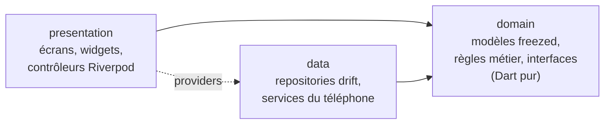
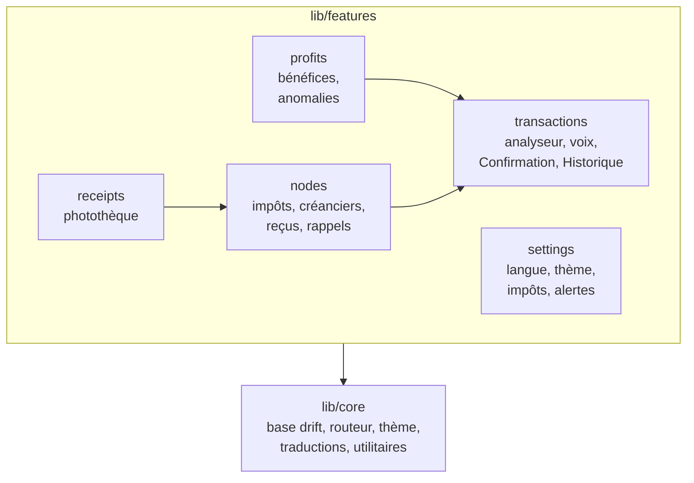
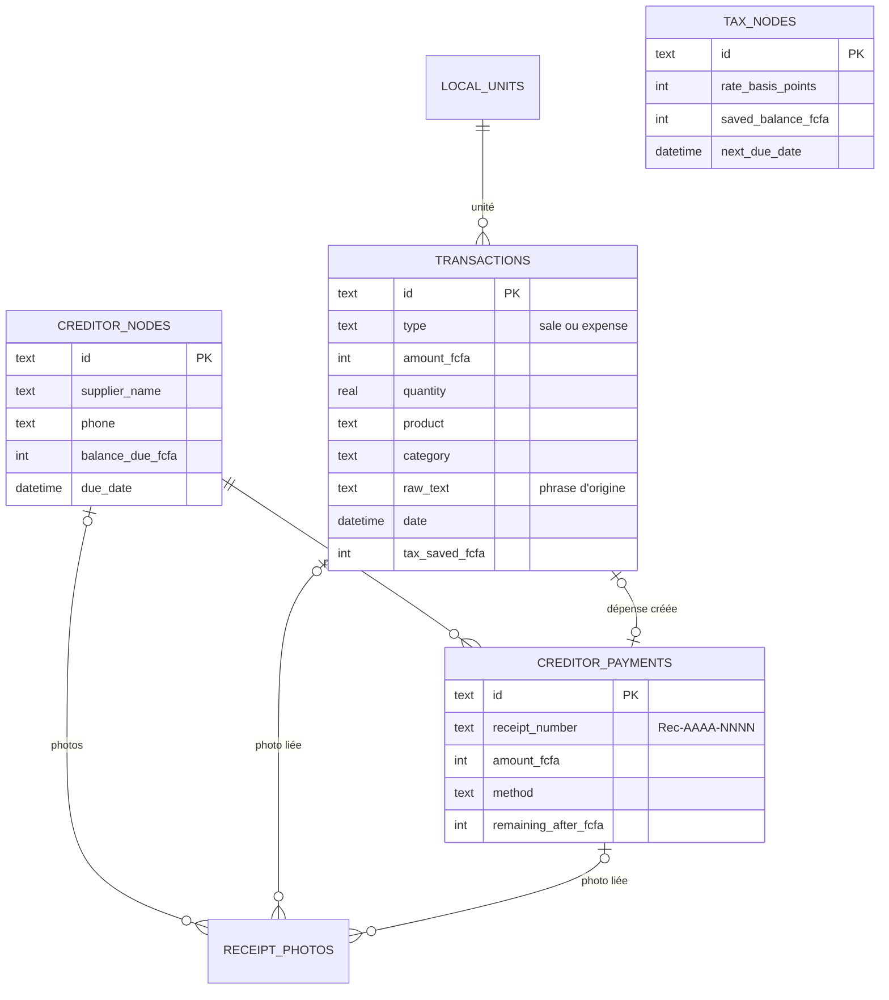
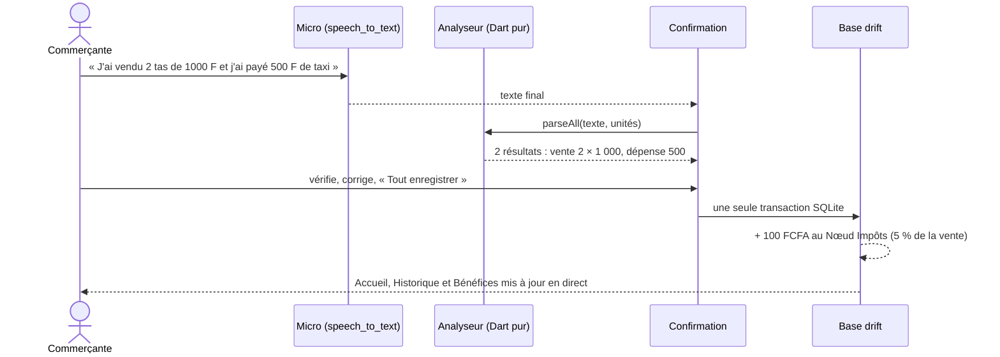

<div align="center">

# NOODO

**Nouez aujourd'hui. Prospérez demain.**

Le carnet de comptes vocal des commerçantes du marché : tu parles, NOODO enregistre, calcule ton vrai bénéfice, met de côté pour tes impôts et garde la trace de ce que tu dois.

[](https://github.com/KABORE-c-elie/NOODO/actions/workflows/ci.yml?query=branch%3Amain)
[](https://github.com/KABORE-c-elie/NOODO/actions/workflows/ci.yml?query=branch%3Adev)
[](LICENSE)

[](https://flutter.dev)
[](https://dart.dev)
[](https://riverpod.dev)
[](https://drift.simonbinder.eu)
[](https://developer.android.com)
[](#tests)

</div>

> **In English —** NOODO is an offline-first Flutter app that helps market traders in Burkina Faso record sales and expenses by voice, see their real profit, set money aside for taxes, track what they owe to suppliers and keep receipts. French first, English available. Source available for review only — all rights reserved.

> Le badge `main` n'a pas encore de statut : la branche `main` n'a pas reçu le travail fait sur `dev` depuis l'ajout de l'intégration continue.

## En bref

| | |
|---|---|
| **Pour qui** | Commerçantes du secteur informel au Burkina Faso, peu à l'aise avec l'écrit, souvent sans réseau sur le marché |
| **Plateforme** | Android 7.0 et plus (testé sur TECNO KM5, Android 15) ; iOS configuré mais pas encore testé |
| **Langues** | Français (par défaut) et anglais, 233 textes traduits ; mooré prévu |
| **Données** | 100 % sur le téléphone, base SQLite en version 4, aucune connexion requise |
| **Code** | 122 fichiers Dart écrits à la main (8 687 lignes, hors code généré) |
| **Tests** | 323 tests automatisés au vert, 2 tests d'intégration, intégration continue sur chaque push |

## Sommaire

- [Fonctionnalités](#fonctionnalités)
- [Captures](#captures)
- [Technologies](#technologies)
- [Architecture](#architecture)
- [Comment ça marche](#comment-ça-marche)
- [Installation](#installation)
- [Tests](#tests)
- [Intégration continue](#intégration-continue)
- [Qualité](#qualité)
- [Conventions du projet](#conventions-du-projet)
- [Limites connues et feuille de route](#limites-connues-et-feuille-de-route)
- [Glossaire](#glossaire)
- [Auteur et licence](#auteur-et-licence)

## Fonctionnalités

### Enregistrer
| | |
|---|---|
| **Tu parles, l'app enregistre** | Un appui sur le micro, une phrase comme « J'ai vendu 2 tas de tomates à 1 000 francs », puis une confirmation. Le texte s'affiche pendant que tu parles. La saisie au clavier reste toujours possible. |
| **Plusieurs opérations dans une phrase** | « J'ai vendu 2 tas de 1000 F et j'ai dépensé 3000 F pour le transport » donne deux cartes : la vente (2 × 1 000 = 2 000 FCFA, le calcul est affiché) et la dépense. Chaque carte se corrige ou se retire, puis « Tout enregistrer ». |
| **Tes unités à toi** | Tas, botte, boîte, sachet, bol, yoruba… au singulier comme au pluriel. Une unité inconnue s'ajoute en un appui et sera reconnue la fois suivante. |
| **Ça ne bloque jamais** | Micro refusé, pas de réseau, rien entendu : un message simple et le bouton « Écrire à la main ». Les champs douteux sont marqués « À vérifier ». |

### Comprendre
| | |
|---|---|
| **Ton vrai bénéfice** | « Aujourd'hui tu as gagné 12 500 FCFA », comparé à la veille. Puis par jour, semaine ou mois, avec la période précédente, la répartition par catégorie et un graphique. |
| **Historique** | Transactions groupées par jour avec le bénéfice de chaque journée, filtres par période, type et catégorie, modification d'un appui, suppression avec « Annuler ». |
| **Alertes** | Une dépense inhabituelle ou une journée nettement moins bonne que d'habitude : une carte avec un conseil simple, au plus une par jour et par type, refermable. |

### Prévoir
| | |
|---|---|
| **Épargne impôts** | À chaque vente, une petite part (5 % par défaut, réglable de 0 à 10 %) va dans le Nœud Impôts ; rappels 15 et 5 jours avant l'échéance. |
| **Fournisseurs** | Un Nœud par créancier : solde dû, échéance, badge « En retard », paiements partiels, rappel la veille de l'échéance. |
| **Reçus** | Chaque paiement produit un reçu numéroté `Rec-AAAA-NNNN`, à partager par WhatsApp ou SMS ; plus personne ne peut dire que tu n'as pas payé. |
| **Photothèque** | Photo des factures et reçus papier, rangée chez le bon fournisseur, retrouvée par fournisseur ou par date, visible dans sa fiche. |
| **Réglages** | Langue, thème clair / sombre / système, taux d'épargne, échéance fiscale, sensibilité des alertes. |

## Captures

Captures prises sur un TECNO KM5 (720 × 1600, Android 15).

| Écran | Clair | Sombre |
|---|---|---|
| Accueil |  |  |
| Historique |  |  |
| Bénéfices |  |  |
| Confirmation |  |  |
| Nœuds |  |  |
| Fiche créancier |  |  |

## Technologies

Versions telles que résolues dans `pubspec.lock`. La dernière colonne mène aux fichiers du dépôt où chaque technologie est utilisée.

### Socle

| Technologie | Version | Rôle dans NOODO | Dans le code |
|---|---|---|---|
| [Flutter](https://flutter.dev) | 3.47.4 (stable) | Interface native Android et iOS à partir d'un seul code | [`main.dart`](lib/main.dart)<br>[`app.dart`](lib/app.dart) |
| [Dart](https://dart.dev) | 3.13.3 | Langage ; l'analyseur de phrases et les calculs sont en Dart pur | [`transaction_parser.dart`](lib/features/transactions/domain/parser/transaction_parser.dart)<br>[`profit_calculator.dart`](lib/features/profits/domain/profit_calculator.dart) |
| [Material 3](https://m3.material.io) | inclus dans Flutter | Composants, thèmes clair et sombre, accessibilité | [`app_theme.dart`](lib/core/theme/app_theme.dart)<br>[`app_colors.dart`](lib/core/theme/app_colors.dart) |

### État, modèles et navigation

| Technologie | Version | Rôle dans NOODO | Dans le code |
|---|---|---|---|
| [flutter_riverpod](https://pub.dev/packages/flutter_riverpod) | 3.4.3 | Gestion de l'état et injection des dépendances (base, horloge, voix, notifications…) | [`app.dart`](lib/app.dart)<br>[`confirmation_fields.dart`](lib/features/transactions/presentation/widgets/confirmation_fields.dart) |
| [riverpod_annotation](https://pub.dev/packages/riverpod_annotation) + [riverpod_generator](https://pub.dev/packages/riverpod_generator) | 4.0.7 / 4.0.9 | Providers déclarés par annotations, code généré et typé | [`database_provider.dart`](lib/core/database/database_provider.dart)<br>[`confirmation_controller.dart`](lib/features/transactions/presentation/confirmation/confirmation_controller.dart) |
| [freezed](https://pub.dev/packages/freezed) + [freezed_annotation](https://pub.dev/packages/freezed_annotation) | 4.0.2 / 3.1.0 | Modèles immuables (transactions, nœuds, brouillons, rapports) avec égalité et `copyWith` | [`transaction.dart`](lib/features/transactions/domain/transaction.dart)<br>[`transaction_draft.dart`](lib/features/transactions/presentation/confirmation/transaction_draft.dart) |
| [go_router](https://pub.dev/packages/go_router) | 18.0.2 | Navigation par URL, barre du bas avec `StatefulShellRoute` | [`app_router.dart`](lib/core/router/app_router.dart)<br>[`app_shell.dart`](lib/core/router/app_shell.dart) |

### Données

| Technologie | Version | Rôle dans NOODO | Dans le code |
|---|---|---|---|
| [drift](https://pub.dev/packages/drift) ([documentation](https://drift.simonbinder.eu)) | 2.35.2 | Base SQLite typée : requêtes, flux en direct, transactions atomiques, migrations | [`app_database.dart`](lib/core/database/app_database.dart)<br>[`drift_transaction_repository.dart`](lib/features/transactions/data/drift_transaction_repository.dart)<br>[`transactions_table.dart`](lib/features/transactions/data/tables/transactions_table.dart) |
| [drift_flutter](https://pub.dev/packages/drift_flutter) | 0.3.1 | Ouverture de la base dans le dossier de l'app | [`app_database.dart`](lib/core/database/app_database.dart) |
| [sqlite3](https://pub.dev/packages/sqlite3) ([SQLite](https://sqlite.org)) | 3.5.2 | Moteur SQLite embarqué ; base en mémoire pour les tests | [`fixtures.dart`](test/helpers/fixtures.dart)<br>[`migration_test.dart`](test/core/database/migration_test.dart) |
| [uuid](https://pub.dev/packages/uuid) | 4.6.0 | Identifiants créés sur le téléphone, prêts pour une future synchronisation | [`confirmation_controller.dart`](lib/features/transactions/presentation/confirmation/confirmation_controller.dart)<br>[`creditor_actions.dart`](lib/features/nodes/presentation/creditor_actions.dart) |

### Fonctions du téléphone

| Technologie | Version | Rôle dans NOODO | Dans le code |
|---|---|---|---|
| [speech_to_text](https://pub.dev/packages/speech_to_text) | 7.5.0 | Reconnaissance vocale du téléphone, en français (`fr_FR`) ou en anglais | [`speech_to_text_service.dart`](lib/features/transactions/data/speech_to_text_service.dart)<br>[`speech_service.dart`](lib/features/transactions/domain/speech/speech_service.dart) |
| [flutter_local_notifications](https://pub.dev/packages/flutter_local_notifications) | 22.3.1 | Rappels d'échéance programmés, reprogrammés après un redémarrage | [`local_notification_scheduler.dart`](lib/features/nodes/data/local_notification_scheduler.dart)<br>[`reminder_sync.dart`](lib/features/nodes/presentation/reminder_sync.dart) |
| [timezone](https://pub.dev/packages/timezone) + [flutter_timezone](https://pub.dev/packages/flutter_timezone) | 0.11.1 / 5.1.1 | Heure locale exacte pour les rappels | [`local_notification_scheduler.dart`](lib/features/nodes/data/local_notification_scheduler.dart) |
| [image_picker](https://pub.dev/packages/image_picker) | 1.2.4 | Photo de reçu avec l'appareil photo, compressée (qualité 70, 1 600 px) | [`photo_storage.dart`](lib/features/receipts/data/photo_storage.dart) |
| [path_provider](https://pub.dev/packages/path_provider) + [path](https://pub.dev/packages/path) | 2.1.6 / 1.9.1 | Dossier privé de l'app pour les photos | [`photo_storage.dart`](lib/features/receipts/data/photo_storage.dart) |
| [share_plus](https://pub.dev/packages/share_plus) | 13.3.1 | Partage des reçus par WhatsApp, SMS… | [`share_plus_receipt_sharer.dart`](lib/features/nodes/data/share_plus_receipt_sharer.dart)<br>[`receipt_dialog.dart`](lib/features/nodes/presentation/widgets/receipt_dialog.dart) |

### Langue et apparence

| Technologie | Version | Rôle dans NOODO | Dans le code |
|---|---|---|---|
| [flutter_localizations](https://docs.flutter.dev/ui/accessibility-and-internationalization/internationalization) | inclus dans Flutter | Traductions générées depuis les fichiers ARB | [`app_fr.arb`](lib/core/l10n/arb/app_fr.arb)<br>[`app_en.arb`](lib/core/l10n/arb/app_en.arb)<br>[`l10n.yaml`](l10n.yaml) |
| [intl](https://pub.dev/packages/intl) | 0.20.3 | Dates et montants au format français (« 12 500 FCFA », « 21 août 2026 ») | [`amount_format.dart`](lib/core/utils/amount_format.dart)<br>[`receipt_text.dart`](lib/features/nodes/presentation/receipt_text.dart) |
| [Nunito](https://fonts.google.com/specimen/Nunito) | 4 graisses embarquées | Police lisible et chaleureuse, embarquée pour marcher hors ligne | [`assets/fonts`](assets/fonts/)<br>[`app_theme.dart`](lib/core/theme/app_theme.dart) |

### Outils de développement

| Technologie | Version | Rôle | Dans le code |
|---|---|---|---|
| [build_runner](https://pub.dev/packages/build_runner) | 2.16.2 | Génération du code (providers, modèles, base de données) | [`app_database.g.dart`](lib/core/database/app_database.g.dart) |
| [drift_dev](https://pub.dev/packages/drift_dev) | 2.35.1 | Génération du code de la base | [`app_database.g.dart`](lib/core/database/app_database.g.dart) |
| [flutter_lints](https://pub.dev/packages/flutter_lints) | 6.0.0 | Règles d'analyse, complétées par des règles du projet | [`analysis_options.yaml`](analysis_options.yaml) |
| [flutter_test](https://api.flutter.dev/flutter/flutter_test/flutter_test-library.html) | inclus dans Flutter | Tests unitaires, de widgets et golden | [`test`](test/)<br>[`screens_golden_test.dart`](test/goldens/screens_golden_test.dart) |
| [integration_test](https://docs.flutter.dev/testing/integration-tests) | inclus dans Flutter | Parcours complets sur un téléphone | [`app_flows_test.dart`](integration_test/app_flows_test.dart) |
| [mocktail](https://pub.dev/packages/mocktail) | 1.0.5 | Doublures de test (reconnaissance vocale) | [`speech_to_text_service_test.dart`](test/features/transactions/data/speech_to_text_service_test.dart) |
| [fake_async](https://pub.dev/packages/fake_async) | 1.3.3 | Contrôle du temps dans les tests (passage à minuit) | [`current_day_provider_test.dart`](test/core/utils/current_day_provider_test.dart) |
| [GitHub Actions](https://docs.github.com/actions) + [subosito/flutter-action](https://github.com/subosito/flutter-action) | v2 | Intégration continue | [`ci.yml`](.github/workflows/ci.yml) |

## Architecture

Le code est organisé par fonctionnalité (`lib/features/…`), chacune découpée en trois couches. La présentation s'appuie sur le domaine ; les données implémentent les interfaces du domaine ; le domaine ne dépend que de Dart.





### Structure du projet

```text
lib/
├── main.dart, app.dart          démarrage, MaterialApp, thème, langue
├── core/
│   ├── database/                AppDatabase (drift, version 4) et migrations
│   ├── l10n/arb/                textes français et anglais
│   ├── router/                  routes go_router et barre du bas
│   ├── theme/                   palettes, AppColors, espacements
│   ├── utils/                   périodes, horloge, jour courant, montants
│   └── widgets/                 composants partagés
└── features/
    ├── transactions/            analyseur, voix, Confirmation, Historique, Accueil
    ├── profits/                 calculs, Bénéfices, anomalies
    ├── nodes/                   Nœud Impôts, créanciers, paiements, reçus, rappels
    ├── receipts/                photothèque
    └── settings/                réglages, données de démonstration (debug)
        └── chaque fonctionnalité : data/ · domain/ · presentation/
test/                            tests unitaires, de widgets et golden
integration_test/                parcours complets sur téléphone
assets/fonts/                    Nunito et sa licence
```

### Écrans et routes

Code : [`app_routes.dart`](lib/core/router/app_routes.dart), [`app_router.dart`](lib/core/router/app_router.dart).

| Route | Écran |
|---|---|
| `/` | Accueil : résumé du jour, alertes, micro, dernières transactions |
| `/history` | Historique |
| `/profits` | Bénéfices |
| `/nodes` | Nœuds : impôts et créanciers |
| `/nodes/creditors/:creditorId` | Fiche créancier |
| `/confirmation?text=…` · `?id=…` | Confirmation d'une phrase, ou modification d'une transaction |
| `/receipts` · `/receipts/:photoId` | Photothèque et photo en grand |
| `/settings` | Paramètres |

### Modèle de données

Code : [`app_database.dart`](lib/core/database/app_database.dart) (tables et migrations), dossiers `data/tables` de chaque fonctionnalité, par exemple [`transactions/data/tables`](lib/features/transactions/data/tables).



Autres tables : `local_units` (unités), `receipt_sequences` (numérotation annuelle des reçus), `receipt_photos`, `app_settings` (langue, thème, sensibilité), `dismissed_anomalies` (alertes fermées). Chaque évolution du schéma a sa migration, testée depuis la version 1 et vérifiée sur un vrai téléphone.

### Choix techniques

| Choix | Pourquoi |
|---|---|
| **Riverpod 3 avec génération de code** | Dépendances explicites et remplaçables en test (base en mémoire, horloge, voix, notifications, appareil photo) ; `select` pour ne reconstruire que ce qui change. |
| **drift (SQLite)** | Requêtes typées, flux qui se mettent à jour seuls, transactions atomiques : une vente et son épargne impôts, ou un paiement, son reçu et sa dépense, sont enregistrés ensemble ou pas du tout. |
| **Montants en entiers** | Le franc CFA n'a pas de centimes ; les entiers évitent toute erreur d'arrondi. |
| **Identifiants UUID** | Créés sur le téléphone, ils ne se heurteront pas à ceux d'un futur serveur. |
| **Taux en points de base** | 500 points de base = 5 % : l'épargne se calcule en entiers, arrondie à l'entier inférieur. |
| **Hors ligne d'abord** | Le marché n'a pas toujours de réseau : tout est stocké et calculé localement. |
| **Analyseur en Dart pur** | Testable sans Flutter ; chaque phrase réelle mal comprise devient un test. |
| **Moteur vocal du téléphone** | Aucun serveur à maintenir ; le français hors ligne dépend du pack de langue installé. |

## Comment ça marche

### Du micro à l'Historique

Code : [`listening_controller.dart`](lib/features/transactions/presentation/voice/listening_controller.dart), [`confirmation_controller.dart`](lib/features/transactions/presentation/confirmation/confirmation_controller.dart), [`drift_transaction_repository.dart`](lib/features/transactions/data/drift_transaction_repository.dart) (`addAll`).



### L'analyseur de phrases

Code : [`transaction_parser.dart`](lib/features/transactions/domain/parser/transaction_parser.dart), [`parser_token.dart`](lib/features/transactions/domain/parser/parser_token.dart) (nombres et fractions), [`category_lexicon.dart`](lib/features/transactions/domain/parser/category_lexicon.dart) · tests : [`multi_transaction_parser_test.dart`](test/features/transactions/domain/multi_transaction_parser_test.dart).

1. **Découpage** sur « et », « puis », « ensuite », « après » et la ponctuation, en regroupant les morceaux qui n'ont ni verbe ni montant (« des tomates, des oignons… »).
2. **Type** : vente (vendu, encaissé, reçu) ou dépense (payé, acheté, dépensé, donné) ; un morceau sans verbe reprend celui d'avant.
3. **Montant** : « 1000 », « 1 000 », « 1.000 », « 1500CFA », ou en lettres jusqu'à « deux mille cinq cents ».
4. **Quantité et unité** : chiffres, « un », « deux », « demi », « la moitié d'un » ; unités du référentiel au singulier comme au pluriel.
5. **Prix unitaire** : « 2 tas de 1000 F », « 2 tas de tomates de 1000 francs », « 250 F chacun », « 1000 F le tas ».
6. **Catégorie** par lexique (légumes, céréales, transport, fournitures, autre).
7. **Confiance** de 0 à 1 ; en dessous de 0,6, les champs manquants sont signalés « À vérifier ».

| Phrase | Résultat |
|---|---|
| J'ai vendu 2 tas de tomates à 1 000 francs | Vente · 2 tas · tomates · légumes · 1 000 FCFA |
| J'ai vendu 3 sachets de piment à 250 F chacun | Vente · 3 sachets · piment · 3 × 250 = 750 FCFA |
| J'ai payé 500 F de taxi, 1000 F de savon et 2000 F de riz | 3 dépenses : transport, fournitures, céréales |
| J'ai vendu deux tas de tomates à 1000 francs et j'ai fait 3000 francs de transport | Vente de 1 000 FCFA, puis 3 000 FCFA de transport « À vérifier » |

### Les calculs

Code : [`profit_calculator.dart`](lib/features/profits/domain/profit_calculator.dart), [`tax_savings_calculator.dart`](lib/features/nodes/domain/tax_savings_calculator.dart), [`anomaly_detector.dart`](lib/features/profits/domain/anomaly_detector.dart).

| Calcul | Règle |
|---|---|
| Bénéfice | ventes − dépenses, sur un jour, une semaine (lundi → dimanche) ou un mois |
| Comparaison | écart avec la période précédente, en FCFA et en %, sans % si la période précédente vaut 0 |
| Épargne impôts | montant de la vente × taux en points de base ÷ 10 000, arrondi à l'entier inférieur |
| Dépense inhabituelle | dépense du jour > moyenne de sa catégorie sur 30 jours × 3 (faible), × 2 (normale), × 1,5 (forte), avec au moins 3 dépenses d'historique |
| Journée faible | bénéfice de la veille < moyenne des jours actifs des 7 jours précédents × 25 % (faible), 50 % (normale), 75 % (forte), avec au moins 3 jours actifs |

### Rappels

Code : [`reminder_planner.dart`](lib/features/nodes/domain/reminder_planner.dart) (dates, Dart pur), [`reminder_sync.dart`](lib/features/nodes/presentation/reminder_sync.dart) (reprogrammation), [`local_notification_scheduler.dart`](lib/features/nodes/data/local_notification_scheduler.dart).

| Échéance | Rappel |
|---|---|
| Impôts | 15 jours puis 5 jours avant, à 9 h |
| Créancier | la veille, à 9 h, seulement s'il reste quelque chose à payer |

Les rappels sont recalculés dès qu'une échéance ou un solde change, et reprogrammés après un redémarrage du téléphone.

### Exemple de reçu

Code : [`receipt_text.dart`](lib/features/nodes/presentation/receipt_text.dart), [`receipt_number.dart`](lib/features/nodes/domain/receipt_number.dart), enregistrement atomique dans [`drift_node_repository.dart`](lib/features/nodes/data/drift_node_repository.dart).

```text
NOODO — ACCUSÉ DE PAIEMENT
N° Rec-2026-0821 | Date : 21 août 2026 à 10h15
Créancier / Fournisseur : Maman Awa (Fournisseur Piment)
Numéro : +226 70 00 11 22
Montant payé : 5 000 FCFA
Moyen : Mobile Money (Orange Money)
Motif : Avance sur livraison de piment vert
Reste à devoir : 2 500 FCFA
```

## Installation

### Prérequis

| Outil | Version |
|---|---|
| [Flutter](https://docs.flutter.dev/get-started/install) | 3.47.4, canal stable (fournit Dart 3.13.3) |
| [Android SDK](https://developer.android.com/studio) | plateforme 36 ; l'app fonctionne dès Android 7.0 (API 24) |
| JDK | 17 |
| Xcode (pour iOS) | version récente ; iOS n'a pas encore été testé |

### Lancer l'application

```bash
git clone https://github.com/KABORE-c-elie/NOODO.git
cd NOODO
flutter pub get
flutter run
```

Les fichiers générés (`*.g.dart`, `*.freezed.dart`, traductions) sont versionnés : l'app se lance sans étape de génération. Après une modification des modèles, des tables ou des providers :

```bash
dart run build_runner build
```

### Commandes utiles

| Commande | Usage |
|---|---|
| `flutter analyze` | Analyse statique |
| `dart format .` | Formatage |
| `flutter gen-l10n` | Régénérer les traductions après une modification des fichiers ARB |
| `flutter build apk --debug` | Construire un APK de test |
| `flutter run --profile` | Mesurer les performances sur un téléphone |

En mode debug, la section « Développement » des Paramètres génère 2 000 transactions de démonstration et programme un rappel de test dans 2 minutes.

### Permissions demandées

| Permission | Usage | Moment de la demande |
|---|---|---|
| Micro (`RECORD_AUDIO`, `NSMicrophoneUsageDescription`) | Dicter une transaction | Au premier appui sur le micro |
| Reconnaissance vocale (`NSSpeechRecognitionUsageDescription`) | Transcrire la voix (iOS) | Au premier appui sur le micro |
| Internet (`INTERNET`) | Reconnaissance vocale en ligne quand le pack hors ligne manque | — |
| Notifications (`POST_NOTIFICATIONS`) | Rappels d'échéance | Quand une échéance est saisie |
| Redémarrage (`RECEIVE_BOOT_COMPLETED`) | Reprogrammer les rappels après un redémarrage | — |
| Appareil photo (`NSCameraUsageDescription`) | Photographier un reçu | À la première photo |

## Tests

État au 11 octobre 2026, compté par `flutter test --reporter json` : **323 tests, tous au vert**, répartis dans 41 fichiers.

| Type | Nombre | Ce qui est vérifié |
|---|---|---|
| Unitaires | 284 | Analyseur (phrases réelles comprises), calculs, repositories sur base en mémoire, migrations v1 → v4, contraste des couleurs, rappels, anomalies |
| Widgets | 35 | Écrans à 360 × 800 (taille d'un petit téléphone) : saisie, Historique, Bénéfices, Nœuds, voix simulée, langue, photothèque |
| Golden | 4 | Accueil et Confirmation, en clair et en sombre |
| Intégration | 2 | Parcours vente et parcours créancier sur l'app complète |

| Commande | Effet |
|---|---|
| `flutter test` | Tous les tests (unitaires, widgets, golden) |
| `flutter test --exclude-tags golden` | Unitaires et widgets, comme la CI |
| `flutter test --tags golden` | Images golden |
| `flutter test --tags golden --update-goldens` | Régénérer les images golden après un changement visuel voulu |
| `flutter test integration_test -d <appareil>` | Tests d'intégration sur un téléphone branché |

Les 2 tests d'intégration n'ont pas encore été exécutés sur un téléphone réel (prévu à l'étape 9).

## Intégration continue

Le workflow [`.github/workflows/ci.yml`](.github/workflows/ci.yml) s'exécute à chaque push et pull request vers `main` et `dev`, sur Ubuntu avec Flutter 3.47.4 :

1. `flutter pub get` ;
2. `dart run build_runner build`, puis `git diff --exit-code` : le code généré versionné doit être à jour ;
3. `dart format --output=none --set-exit-if-changed .` ;
4. `flutter analyze` ;
5. `flutter test --coverage --exclude-tags golden`.

Les tests golden sont exclus de la CI : le rendu des polices diffère entre Windows, où les images de référence sont produites, et le Linux de GitHub.

## Qualité

**Accessibilité**
- Chaque élément interactif a une infobulle ou un libellé pour les lecteurs d'écran ; chaque transaction, barre de graphique et carte se lit en une phrase.
- Actions de remplacement pour les gestes (supprimer sans glisser), annonces en direct (texte dicté, période affichée), animations figées si le téléphone le demande.
- Contraste WCAG AA vérifié par des tests sur tous les fonds des deux thèmes, y compris le vert et le rouge des montants.
- Cibles tactiles d'au moins 48 px, bouton micro de 112 px.

**Internationalisation**
- Tous les textes sont dans `lib/core/l10n/arb/` (français de référence, anglais), y compris les reçus et les notifications.
- La langue choisie s'applique aussi à la reconnaissance vocale.

**Apparence**
- Thèmes clair et sombre conçus séparément : neutres chauds, orange désaturé en sombre.
- Couleurs métier centralisées (`AppColors` : vente, dépense, épargne, alerte), espacements et arrondis partagés.
- Montants en chiffres de même largeur pour qu'ils s'alignent, signe « − » pour les pertes.

**Performances**
- Widgets `const` partout où c'est possible, `ref.watch(provider.select(...))` pour ne reconstruire que la partie qui change.
- Listes construites à la demande (`ListView.builder`, `SliverList.builder`, `GridView.builder`) et pagination par curseur dans l'Historique.
- Animation d'écoute et graphique isolés dans un `RepaintBoundary`.
- Miniatures de photos décodées à la taille affichée (`ResizeImage`, équivalent de `cacheWidth`).

## Conventions du projet

- **Branches** : `dev` reçoit le travail courant, `main` sert de référence.
- **Commits** au format [Conventional Commits](https://www.conventionalcommits.org/fr/v1.0.0/) (`feat:`, `fix:`, `docs:`, `test:`, `ci:`, `chore:`).
- **Code sans commentaires** : les noms doivent suffire.
- **Code généré versionné** et vérifié par la CI.
- **Règles d'analyse** : celles de `flutter_lints`, plus `prefer_const_constructors`, `prefer_final_locals` et `always_use_package_imports`.
- **Tests à la taille réelle** : les tests de widgets tournent à 360 × 800.
- **Historique des versions** : voir le [CHANGELOG](CHANGELOG.md).

## Limites connues et feuille de route

**Limites actuelles**
- **Mobile Money simulé** : le moyen de paiement est enregistré, aucun argent ne circule.
- **Aucune synchronisation serveur** : les données ne quittent pas le téléphone, sans sauvegarde distante.
- **Reconnaissance vocale** : la qualité hors ligne et dans le bruit dépend du téléphone ; les essais sur téléphone réel restent à terminer.
- **Analyseur** : les unités en plusieurs mots, certains nombres en lettres (« quatre-vingts ») et les verbes non reconnus (« j'ai mis… ») demandent une vérification, signalée par « À vérifier ».
- **iOS** : configuré (textes des permissions) mais pas encore testé sur un appareil.
- La police Nunito ne contient pas l'espace fine insécable des montants en français : elle est dessinée par la police de secours.

**Feuille de route**
- Intégration Mobile Money réelle (Orange Money, Moov Money) pour l'épargne impôts et le paiement des fournisseurs.
- Mooré, puis d'autres langues locales, pour l'interface et la voix.
- Synchronisation chiffrée avec un serveur, avec gestion des conflits.
- Reconnaissance du montant et du fournisseur directement depuis la photo du reçu.

## Glossaire

| Terme | Sens |
|---|---|
| **FCFA** | Franc CFA, monnaie du Burkina Faso ; sans centimes |
| **Nœud** | Poche d'argent dédiée : le Nœud Impôts pour l'épargne fiscale, un Nœud Créancier par fournisseur |
| **Tas, botte, yoruba** | Unités du marché : un tas de tomates, une botte d'oseille, une boîte de mesure (yoruba) |
| **Points de base** | Centièmes de pour cent : 500 points de base = 5 % |
| **Mooré** | Langue la plus parlée au Burkina Faso, prévue pour une prochaine version |

## Auteur et licence

Conçu et développé par **KABORE Caliste Elie**.

Copyright (c) 2026 KABORE Caliste Elie. **Tous droits réservés.**

Ce code source est rendu public uniquement à des fins de consultation et d'évaluation. Toute reproduction, modification, distribution ou utilisation commerciale, totale ou partielle, est interdite sans l'autorisation écrite préalable de l'auteur. Le texte complet figure dans [LICENSE](LICENSE).

**Composants tiers** : ils restent soumis à leur propre licence.
- La police **[Nunito](https://fonts.google.com/specimen/Nunito)**, sous [SIL Open Font License 1.1](https://openfontlicense.org) (texte inclus dans [`assets/fonts/OFL.txt`](assets/fonts/OFL.txt)).
- Les packages Dart et Flutter listés dans la section [Technologies](#technologies), chacun sous la licence indiquée sur sa page [pub.dev](https://pub.dev).
- Les icônes [Material](https://fonts.google.com/icons), fournies par le SDK Flutter.
